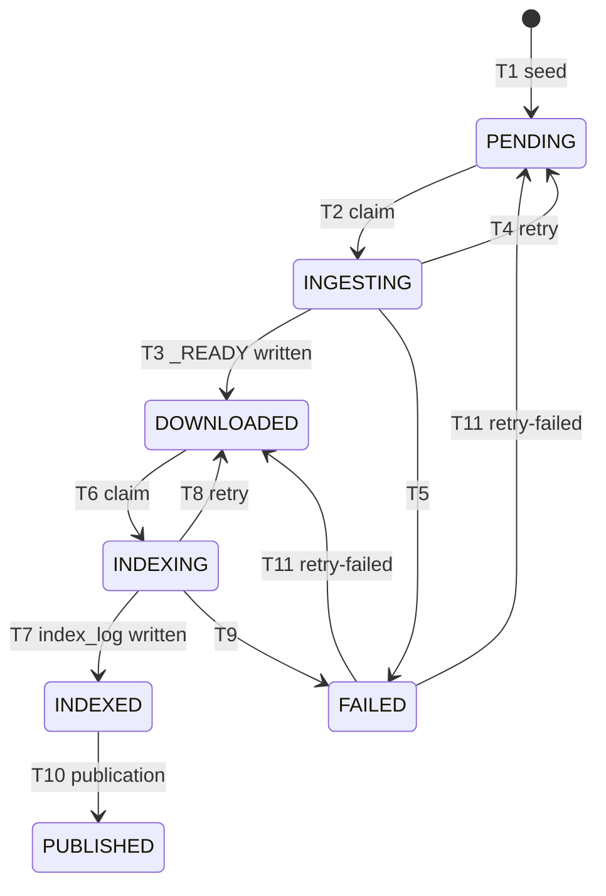

# Coordination contract (Hazelcast)

**Owner:** Carlos Falcón (CF-02). **Readers and writers:** Control Module, Ingestion Service,
Indexing Service, Search Service. **Implemented by:** `common/coordination` (CF-04); no
service names a structure or builds a `BookTask` by hand.

**Status: v1.3.** v1.0 approved in PR #17; v1.1 adds its review notes (fencing of the
publication in §5, an interrupted T10 in §7, split-brain in §9); v1.2 the review notes of #19
(dropped ids are counted, not logged, §1 and §2); v1.3 the details of the recovery found while
implementing it (CF-10, §7: `index_books` only up to `CURRENT`, never backwards, read before
writing, what is lost). Implemented by
`common/coordination` (CF-04). Changing anything in this file (names, fields, states,
transitions) needs the approval of the other two members (plan §7). A change of the `BookTask`
fields also means emptying the cluster (`docker compose restart hz-1 hz-2`): the stored
entries keep the old format.

This contract covers what goes through Hazelcast. The other non-HTTP contracts are the datalake
by ranges and `<id>._READY` (plan §6.2), the `books` collection (§6.3) and the index publication
in MongoDB (§6.5). The inventory of all interactions is `api/endpoints.md`.

## 1. Principles

1. **Hazelcast coordinates, it does not store.** It holds who does what and in which state each
   book is. It is in memory only: if both members stop, it is lost. The persistent truth is the
   datalake and MongoDB, and the Control Module rebuilds the state from them (§7).
2. **A state is written only after its evidence is persistent.** `DOWNLOADED` only after
   `<id>._READY` exists, `INDEXED` only after `index_log` has the book, `PUBLISHED` only after
   `CURRENT` points to a version that contains it. So the recovery of §7 never promotes a book
   that is not really there.
3. **`book-state` is the truth, the queues are work to do.** An id can be in a queue twice or
   be in a queue while its state says something else: whoever takes it checks the state with an
   atomic claim and discards it if it is not the expected one. Duplicates in a queue are
   therefore harmless; they are counted (`Coordination.idsSkipped()`, a coordination metric).
4. **Every change is atomic.** A transition is a compare-and-set, `replace(id, expected, next)`:
   it succeeds only if the entry is still exactly the value the caller read. A transition that
   also moves the id to or from a queue runs in **one Hazelcast transaction** with that queue
   operation, so a crash never leaves one done without the other.
5. **Work is idempotent.** Repeating a download (atomic file write), an indexing (upserts and
   `$addToSet`) or a seed (`putIfAbsent`) does not duplicate anything, so retrying is always safe.

## 2. Structures

| Name | Type | Key → value | Written by | Read by |
|---|---|---|---|---|
| `book-state` | `IMap<Integer, BookTask>` | book id → state of the book (§3) | Control, Ingestion, Indexing | Control, Ingestion, Indexing |
| `ingest-queue` | `IQueue<Integer>` | book id to download | Control (offer), Ingestion (offer on retry) | Ingestion (poll) |
| `index-queue` | `IQueue<Integer>` | book id to index | Ingestion (offer), Control (offer on retry/recovery), Indexing (offer on retry) | Indexing (poll) |
| `index-events` | `ReliableTopic<IndexPublished>` | one message per published version (§6) | Indexing | Search (every replica) |
| `locks` | `IMap<String, String>`, key `index-writer` | lock of the single index writer (§5); the map stays empty, only its lock is used | Indexing | Indexing |
| `coordination-meta` | `IMap<String, Long>`, key `initialized` | time (epoch ms) of the last full seed or recovery; its absence means the cluster lost its state (§7) | Control | Control |

- Book ids are `int` from 1 to 999,999,999, the rule of `BookIds` in `common`. A consumer drops
  an id that is not valid and counts it (`Coordination.invalidIdsDropped()`, shown in the
  `GET /status` of the service): not 0 means someone offered a bad id. The library does not log;
  the service decides.
- Values use Hazelcast **Compact serialization** (records of `common/coordination`). The members
  run the official image without our classes: they store, compare and query Compact data
  without them. That is why the transitions use `replace` and not an `EntryProcessor` (which
  would need our jar on every member).
- The type name of a Compact record is its fully qualified class name: every service must use
  the classes of `common/coordination`, never a copy.
- Cluster settings (backups, the index on `state`, queue and topic limits) are in
  `hazelcast/hazelcast.yaml` (CF-03): `backup-count: 1` on every structure, so the loss of one
  member loses nothing.

## 3. `BookTask`

| Field | Type | Meaning |
|---|---|---|
| `bookId` | `int` | The key, repeated so that a value is self-describing |
| `state` | `String` | One of the states of §4 (the enum name, so that queries work without our classes) |
| `owner` | `String` or `null` | Worker that holds the lease: `<service>-<hostname>/w<n>`, e.g. `ingestion-3f2a1c9e/w2`. `null` outside `INGESTING` and `INDEXING` |
| `leaseUntil` | `long` | Epoch ms until which the owner may work on the book; `0` when there is no owner |
| `attempts` | `int` | Failed attempts **in the current stage** (ingestion or indexing); back to 0 when a stage completes |
| `failedStage` | `String` or `null` | `INGESTION` or `INDEXING` when `state` is `FAILED`, else `null` |
| `lastError` | `String` or `null` | `<CODE>: <message>` of the last failure (§4.3), kept for diagnosis |
| `enqueuedAt` | `long` | Epoch ms when the id entered its current queue |
| `startedAt` | `long` | Epoch ms of the claim of the current or last stage |
| `finishedAt` | `long` | Epoch ms when the last stage completed |

The three timestamps give the coordination metrics of CF-12: time waiting in the queue
(`startedAt − enqueuedAt`) and work time (`finishedAt − startedAt`). Times use the clock of the
process that writes them; in Stage 2 every container shares the host clock (§9).

## 4. States and transitions

### 4.1 Transitions

"Tx" means that the map change and the queue operation run in one transaction (principle 4).

| # | From → to | Who | When | Queue (same tx) |
|---|---|---|---|---|
| T1 | (absent) → `PENDING` | Control | Seeding (`shared/book_ids.txt` or `POST /control/jobs`): `putIfAbsent`. An id already present is left as it is, whatever its state | offer `ingest-queue` |
| T2 | `PENDING` → `INGESTING` | Ingestion worker | Claim: sets `owner`, `leaseUntil`, `startedAt` | poll `ingest-queue`; if the state is not `PENDING`, the poll is committed and the id discarded |
| T3 | `INGESTING` → `DOWNLOADED` | Ingestion (owner) | `<id>._READY` exists: written now, or already there (`already_available`, no download). Clears the lease, `attempts = 0`, sets `finishedAt` | offer `index-queue` |
| T4 | `INGESTING` → `PENDING` | Ingestion (owner) on a transient error; Control on an expired lease | `attempts + 1 < MAX_ATTEMPTS`. Clears the lease, sets `lastError` | offer `ingest-queue` |
| T5 | `INGESTING` → `FAILED` | Ingestion (owner) on a permanent error; Ingestion or Control when `attempts + 1 ≥ MAX_ATTEMPTS` | `failedStage = INGESTION`, sets `lastError` | — |
| T6 | `DOWNLOADED` → `INDEXING` | Indexing (writer) | Claim, as T2 | poll `index-queue`, as T2 |
| T7 | `INDEXING` → `INDEXED` | Indexing (owner) | The book is in `index_log` (after its posting lists). Clears the lease, `attempts = 0`, sets `finishedAt` | — |
| T8 | `INDEXING` → `DOWNLOADED` | Indexing (owner) on a transient error; Control on an expired lease | As T4 | offer `index-queue` |
| T9 | `INDEXING` → `FAILED` | As T5 | `failedStage = INDEXING` | — |
| T10 | `INDEXED` → `PUBLISHED` | Indexing | During `POST /index/publish`, after `CURRENT` points to the new version. Plain `replace`, no queue: if it is interrupted, §7 fixes it from `index_books` | — |
| T11 | `FAILED` → `PENDING` or `DOWNLOADED` | Control | `POST /control/retry-failed`: back to the start of `failedStage`, `attempts = 0`, `failedStage = null` (`lastError` is kept) | offer `ingest-queue` or `index-queue` |

Any other change of state is a bug. A transition whose `replace` fails (someone changed the
entry first) is not retried blindly: the caller reads the entry again and decides. In
particular a worker whose completion fails **has lost its lease** (the Control requeued the
book): it stops and discards its result. Thanks to idempotency, whatever it already wrote is
harmless.

The HTTP administration endpoints (`POST /ingest/{id}`, `POST /index/update/{id}`) run the same
work outside this flow and do not change `book-state`. A book indexed that way is published
with the next version anyway (the publication reads `index_log`, plan §6.5).

### 4.2 Leases

- The claim (T2, T6) writes `leaseUntil = now + LEASE_SECONDS`. Each claimant reads
  `LEASE_SECONDS` from its own environment (default 120 s, much longer than one download or
  indexing). A worker that needs longer may renew: `replace` of its own entry with a later
  `leaseUntil`.
- Every `LEASE_CHECK_SECONDS` (default 10 s) the Control queries
  `state IN ('INGESTING', 'INDEXING') AND leaseUntil < now` and applies T4/T8, or T5/T9 when
  the attempts are used up, with `lastError = LEASE_EXPIRED`.
- The owner can complete while its entry is unchanged, even a little after `leaseUntil`: what
  matters is that nobody has requeued the book yet.

### 4.3 Errors and attempts

| Code (`lastError`) | Raised by | Kind | Effect |
|---|---|---|---|
| `NOT_FOUND` | Ingestion: Gutenberg answers 404 | permanent | T5 |
| `INVALID_BOOK` | Ingestion: no `*** START` / `*** END` markers (the 422 of `POST /ingest`) | permanent | T5 |
| `EMPTY_BOOK` | Indexing: no indexable term (422 of `POST /index/update`) | permanent | T9 |
| `DOWNLOAD_FAILED` | Ingestion: timeout, connection error or 5xx of Gutenberg, after its own retries with backoff | transient | T4 (or T5 when out of attempts) |
| `NOT_READY` | Indexing: the book has no `<id>._READY` (should not happen) | transient | T8 (or T9) |
| `LEASE_EXPIRED` | Control: the owner did not finish in time (it died or hung) | transient | T4/T8 (or T5/T9) |
| `STORAGE_UNAVAILABLE` | Indexing: MongoDB does not answer | outage, **not counted** | T8 with the same `attempts`; the consumer pauses with backoff before taking more ids |
| `INTERNAL_ERROR` | Anyone: unexpected exception | transient | T4/T8 (or T5/T9) |

`MAX_ATTEMPTS` (default 3) counts failed attempts in one stage. A MongoDB outage does not count
because it is not the book's fault: otherwise one outage would send every book in flight to
`FAILED`.

## 5. Writer lock `index-writer`

- It is `IMap.lock("index-writer")` on the map `locks`. **Not** a CP `FencedLock`: the CP
  Subsystem is an Enterprise feature in Hazelcast 5.7 and `getCPSubsystem().getLock()` throws
  `UnsupportedOperationException` (plan §3.3, limit 3; measured in the CF-01 demo).
- The Indexing replica that holds it is the only one that claims from `index-queue` and writes
  the index. Another replica blocks in `lock()` as a standby and takes over when the holder dies.
- Hazelcast releases the lock when the holder's connection closes: measured 5–10 s after a
  `kill -9`, up to the client heartbeat timeout (60 s by default) if the process hangs without
  closing the connection.
- The lock belongs to the **thread** that took it: the same thread must call `unlock()`.
- If the client loses the cluster (`LifecycleEvent CLIENT_DISCONNECTED`), the writer stops
  writing at once: when the cluster comes back the lock may be gone (§7). It takes the lock
  again before writing anything else.
- There is no fencing token: a writer that froze and comes back late is not stopped by
  Hazelcast. Its claims fail once the Control has requeued its books, and the writes of
  indexing are idempotent, so for them the damage is limited to repeated work. A publication
  is not idempotent (a late writer could move `CURRENT` back and hide books), so it uses the
  version itself as the fencing token (DR-08): `CURRENT` changes with
  `updateOne({_id: "CURRENT", version: V}, {$set: {version: V+1, …}})`, the first version with
  an `insertOne` that fails if it exists, and a publication whose update matches nothing is
  aborted. To be stated in the report.

## 6. Event `index-events`

`IndexPublished` (Compact record of `common/coordination`), the same fields as the body of the
200 of `POST /index/publish`:

| Field | Type | Meaning |
|---|---|---|
| `version` | `int` | Version that `CURRENT` points to now |
| `booksPublished` | `int` | Books that became visible in this version (> 0) |
| `totalBooks` | `int` | Books visible in total |
| `publishedAt` | `String` | ISO-8601 UTC, e.g. `2026-11-03T10:15:00Z` |

- Indexing publishes it after `CURRENT` has switched (plan §6.5), only when a new version is
  created (`books_published > 0`).
- The event is only a **wake-up**: on receiving it, a Search replica reads `CURRENT` from
  MongoDB and reloads only if the version is newer than the one it serves. A lost, repeated or
  out-of-order event therefore does no harm, and the periodic check of `CURRENT`
  (`SEARCH_POLL_SECONDS`) covers lost ones.

## 7. Failures and recovery

| Failure | What happens | Who fixes it |
|---|---|---|
| A worker dies between the poll and the claim | The transaction is rolled back and the id goes back to the queue | Hazelcast |
| An Ingestion worker dies while downloading | The book stays `INGESTING` until its lease expires; the files are written atomically, so at most a temp file is left | Control (T4) |
| It dies after `_READY` but before T3 | Same; the next worker finds `_READY` and completes T3 without downloading | Control (T4) + `already_available` |
| Indexing dies while indexing, or before T7 | Lease expires, the book is indexed again (idempotent) | Control (T8) |
| Indexing dies while holding `index-writer` | The lock is released in 5–60 s and a standby replica takes over | Hazelcast |
| The Control dies | Workers keep consuming the queues; leases are not reviewed and nothing is published until it restarts. Seeding is idempotent | Restart |
| One Hazelcast member dies | Nothing is lost (backup). While only one member runs there is no copy; when it rejoins, the partitions migrate back in 1–4 s and the cluster is not *safe* meanwhile | Hazelcast |
| Indexing dies after `CURRENT` switched but before T10 (cluster alive) | The books are visible but stay `INDEXED` in `book-state`; the recovery below does not run, `coordination-meta` is still there | Indexing (DR-08): at startup and before each publication it applies T10 again to the `INDEXED` books that are already in `index_books` |
| **Both members die** (or the cluster restarts) | `book-state`, the queues, the lock and `coordination-meta` are lost; clients reconnect when it is back | Control: recovery below |

**Recovery (CF-10).** The Control checks `coordination-meta.initialized` at startup and on every
lease check. If it is missing, it rebuilds `book-state`, from the most advanced evidence:

1. `index_books` in MongoDB, with a version up to the one of `CURRENT` → `PUBLISHED` (a book
   above `CURRENT` belongs to a publication that did not switch it, so it is not visible);
2. else `index_log` → `INDEXED` (the next publication makes it visible);
3. else `<id>._READY` in the datalake → `DOWNLOADED`, offered to `index-queue`;
4. then it seeds `CONTROL_SEED_FILE` again (T1), so the remaining ids become `PENDING`;
5. finally it writes `coordination-meta.initialized`.

Every source is read before anything is written: if one fails (MongoDB down) nothing changes,
the marker stays missing and the next lease check tries again. Restoring never moves a book
backwards: an entry that already exists is left as it is, except a `PENDING` one (seeded while
the recovery ran), which moves forward; the worker that polls its old id from `ingest-queue`
drops it (§2). A book submitted with `POST /control/jobs` that had no evidence yet (`PENDING`,
`INGESTING`) and is not in `CONTROL_SEED_FILE` is lost: submit it again.

Books that were `INGESTING`, `INDEXING` or `FAILED` come back at the stage their evidence
says and are redone; the late completion of a worker that was busy during the loss fails its
`replace` and is discarded. The Control needs the datalake mounted read-only for step 3.

## 8. Configuration

Read by `common/coordination` from environment variables, with these defaults:

| Variable | Default | Used by |
|---|---|---|
| `HZ_MEMBERS` | `localhost:5701,localhost:5702` (in Docker: `hz-1:5701,hz-2:5701`) | all |
| `HZ_CLUSTER_NAME` | `search-engine` | all |
| `LEASE_SECONDS` | `120` | Ingestion, Indexing |
| `MAX_ATTEMPTS` | `3` | Ingestion, Indexing, Control |
| `LEASE_CHECK_SECONDS` | `10` | Control |

## 9. Limits

- Everything in Hazelcast is lost if both members stop: hence principle 2 and §7.
- `IMap.lock` has no fencing token (§5). In a network partition (split-brain) each half of
  the cluster could grant it; on one host with one Indexing replica this cannot happen, in
  Stage 3 it can.
- Leases compare clocks of different processes. On one host they share the clock; in Stage 3,
  on several machines, they need NTP, or a margin larger than the expected clock skew.
- Transactions cost extra round trips per transition. Their cost is part of the coordination
  cost measured in CF-13.

## 10. Verified against the cluster

On 2026-11-04, Hazelcast 5.7.0, the two members of `docker-compose.yml` (CF-01 demo and a
probe for this contract):

| Assumption of this contract | Result |
|---|---|
| A Compact record is stored, read back and compared by members that do not have the class | yes |
| `replace(id, expected, next)` succeeds with an equal (not the same) `expected` and fails if the entry changed | yes |
| A query on `state` and `leaseUntil` runs on the members | yes |
| A transaction applies a map change and an `offer` together; if the client dies before the commit, neither | yes |
| A polled id goes back to the queue when its transaction is rolled back | yes |
| Two workers on one queue never process the same id | yes (20 books: 10 and 10) |
| CP `FencedLock` in the free edition | **no**: Enterprise feature |
| `IMap.lock` of a killed process is released | yes, after 5–10 s |
| One member down loses nothing | yes (1,000 entries) |
